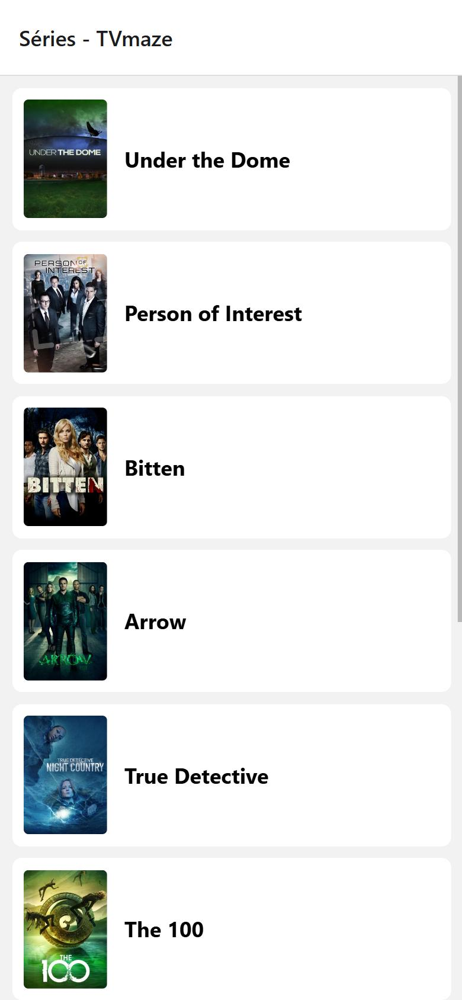
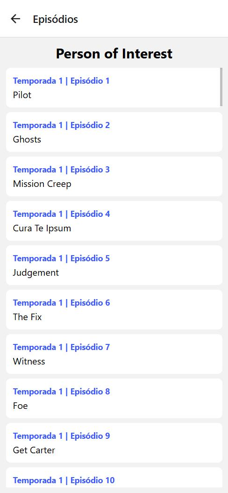

# CP3 - App de Séries (TVmaze)

Aplicativo feito em React Native com Expo que consome a API pública do [TVmaze](https://www.tvmaze.com/api).

## Telas

- **Tela inicial:** lista as séries de `https://api.tvmaze.com/shows`, mostrando a imagem e o nome.
- **Tela de detalhes:** ao tocar em uma série, mostra o nome dela e a lista de episódios de `https://api.tvmaze.com/shows/{id}/episodes` (temporada, número e nome).

## O que foi usado

- Stack Navigator (`@react-navigation/native-stack`)
- `FlatList` para as listas
- `useState` e `useEffect`
- `fetch` com `async/await` e `try/catch/finally`
- `ActivityIndicator` no carregamento e mensagem de erro nas duas telas
- O `id` da série é passado para a tela de detalhes por `route.params`

## Como rodar

```bash
npm install
npx expo start
```

Depois é só abrir no Expo Go pelo QR Code (ou apertar `w` para abrir no navegador).

## Prints

| Tela inicial | Tela de detalhes |
| --- | --- |
|  |  |
